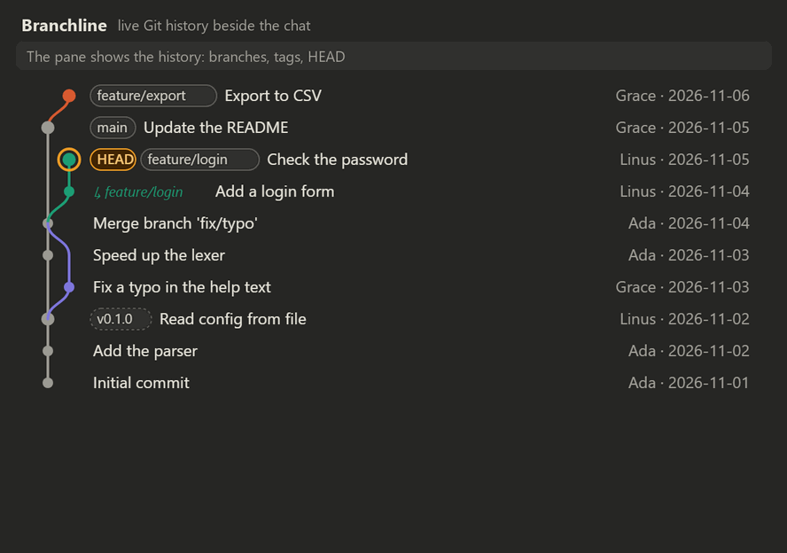
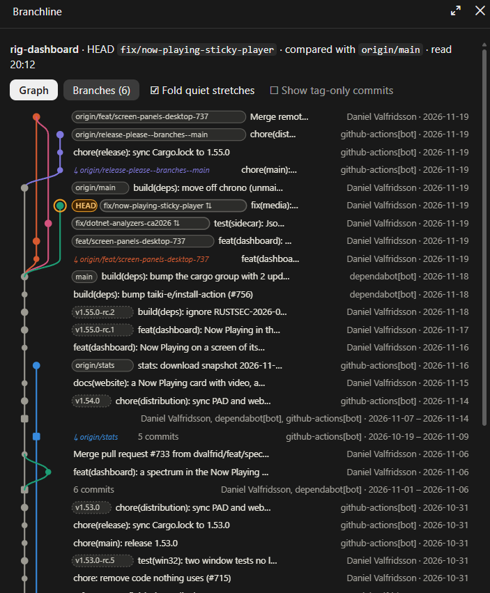
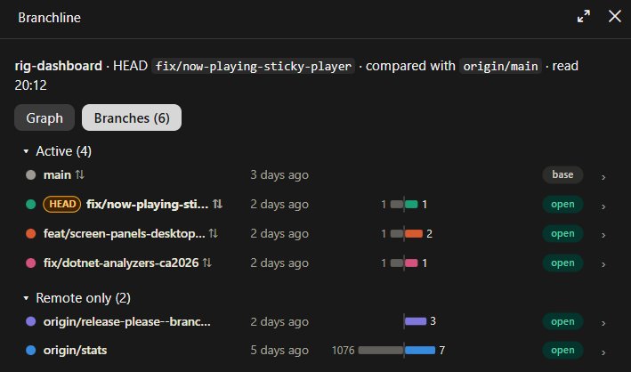
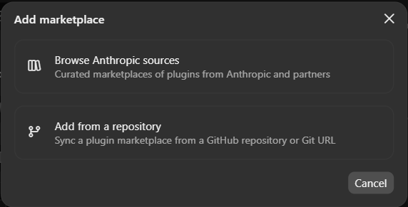
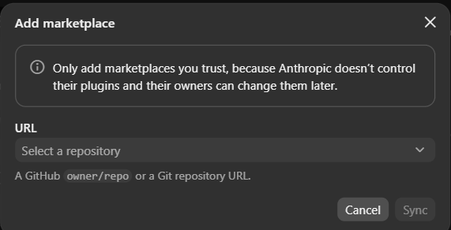
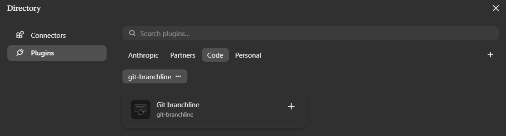
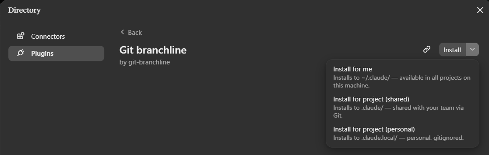

# Branchline

[](https://github.com/dvalfrid/git-branchline/actions/workflows/checks.yml)

[git-branchline.codeby.se](https://git-branchline.codeby.se)

`git-branchline` is a Claude Code mod that shows the Git history of the
session's repository in a pane beside the chat: branches, tags, remotes,
where `HEAD` is, and how each branch stands against the default branch. The
pane updates by itself when the history changes: a commit, fetch, pull,
checkout or merge, whether Claude ran it or you did in a terminal or another
Git client.



## Features

- **Graph tab**: the commit graph, colored by branch, with ref pills, `HEAD`
  marked and hover tooltips. Long quiet stretches fold into one row when the
  graph does not fit, and commits only a tag keeps are hidden; two check
  boxes change both (see Settings).
- **Branches tab**: branches grouped as Active, Local and remote, Remote only
  and Old local, with age, ahead/behind bars and status, the first 30 of a
  group at a time. Open a branch to see its commits and most changed files,
  ask Claude about it, copy its name, or delete it.
- **A row above the prompt** opens the pane while it is closed, with the
  checked-out branch and how it stands against the base.
- **Terminal**: a text graph in the style of `git log --graph`.
- `/branchline` opens the pane and reads the repository again.

 

Branchline only reads the repository. The one exception: it can delete a
**merged local** branch with `git branch -d` (which refuses unmerged work),
after two presses. Anything else that changes the repository, such as
`git branch -D` or deleting a branch on a remote, is handed to Claude as a
prompt for you to send, and runs with Claude's usual permission prompts.

## Try it

In any session whose folder is a Git repository:

- Type `/branchline`. The pane opens on the Graph tab and shows the history.
- Ask Claude to "make a branch called demo and commit a small change on it".
  The new branch and its commit appear in the graph as the commit lands.
- Open the **Branches** tab and press a branch: its commits and most changed
  files show, with buttons to ask Claude about it or copy its name.
- Ask Claude "which of my branches are merged into main?", then delete one
  of them from the Branches tab with **Delete** and the confirmation.

## Install

At the prompt of a Claude Code terminal session:

```
/plugin install git-branchline --marketplace dvalfrid/git-branchline
```

Answer `y` to add the marketplace, then pick a scope (user scope loads it in
every session).

From a shell:

```
claude plugin install git-branchline --marketplace dvalfrid/git-branchline
```

In the Claude desktop app, where `/plugin` does not run:

1. Open **Plugins**: in the left sidebar, or under **Settings** → **Plugins**,
   depending on the app's version. Press **Add**, then **Add marketplace**
   and **Add from a repository**.

   

2. Enter `dvalfrid/git-branchline` as the URL and press **Sync**.

   

3. The **Directory** opens on the marketplace. Pick **Branchline** (or press its
   **+**).

   

4. Choose **Install** → **Install for me** to have it in every project on
   this machine, or a project scope to share it through `.claude/` or keep
   it in `.claude.local/`.

   

A plugin installed from a terminal at the user scope also loads in the
desktop app.

The install clones over SSH and falls back to HTTPS, so no GitHub key is
needed. An update clones over SSH without that fallback: if it fails with
"Permission denied (publickey)", see the [FAQ](#faq). It may say that two userConfig options are not set: both have
defaults (see Settings), so there is nothing to configure.

Requires Git on `PATH`. Git 2.41 or later reads ahead/behind counts in one
call; older versions fall back to one `rev-list` per branch, which takes
seconds in a repository with hundreds of branches. Tried with Git 2.56.

Needs Claude Code 2.1.284 or later. An older version refuses the mod's code,
and the pane does not load (see the [FAQ](#faq)). The tests pass from 2.1.284;
it is tried by hand with 2.1.326 and later, in the desktop app and the
terminal. The mod API also changes between versions: if a newer Claude Code
breaks Branchline, say so in an issue.

### Update and uninstall

A new release reaches you when you ask for it, then restart Claude Code:

```
claude plugin update git-branchline@git-branchline
```

Claude Code can also update it by itself. That is off by default for a
marketplace that is not Anthropic's. To turn it on, run `/plugin` in a Claude
Code session in a terminal, open the Marketplaces tab, select `git-branchline`
and turn on auto-update. Alternatively, add `"autoUpdate": true` next to
`source` in the marketplace's entry under `extraKnownMarketplaces` in
`~/.claude/settings.json`. The update runs a few minutes after your first
message in a session and applies after `/reload-plugins` or the next start.

To remove it:

```
claude plugin uninstall git-branchline@git-branchline
claude plugin marketplace remove git-branchline
```

## Known issues

- In the desktop app, after a click in the pane, it can stop scrolling a
  couple of rows short of its top while it holds the keyboard. Press Esc (the
  pane says so). Reported as
  [anthropics/claude-code#111465](https://github.com/anthropics/claude-code/issues/111465).
- In VS Code, a pane cannot be scrolled from code
  ([anthropics/claude-code#104733](https://github.com/anthropics/claude-code/issues/104733)).
  Branchline has not been tried there yet.
- In the Claude mobile app, following a session on your computer through
  Remote Control, `/branchline` works (it answers "Branchline updated.") but
  the pane is not shown: the app has no place for a mod's pane there. Use the
  desktop app or the terminal to see it.

## FAQ

### The pane does not open, or "hooks module did not load"

```
git-branchline: hooks module did not load: …register.tsx, compiled line …:
$ is passed to "update", imported from "claude-code": …
```

The Claude Code you run is older than 2.1.284, which Branchline needs. Check
with `claude --version`. The desktop app and the `claude` command in a
terminal update separately: the desktop app runs a copy of its own, so a
current desktop app says nothing about the `claude` on your `PATH`. Update
the terminal one with `claude update`, and the desktop app from its own menu,
then start a new session.

### The update fails with "Permission denied (publickey)"

```
× Failed to update plugin "git-branchline@git-branchline": Failed to clone repository: …
Load key "/c/Users/you/.ssh/key.pub": invalid format
git@github.com: Permission denied (publickey).
```

Your own `git` and `gh` can work over SSH while this fails. Claude Code
clones the plugin from `git@github.com:` and runs Git with its own SSH
command, `ssh -o BatchMode=yes -o StrictHostKeyChecking=yes`. That overrides
`core.sshCommand` in your `.gitconfig`. On Windows the bare `ssh` then is the
one bundled with Git for Windows (`C:\Program Files\Git\usr\bin\ssh.exe`),
and that one cannot reach an SSH agent such as 1Password or the Windows
OpenSSH agent. If your key lives only in the agent, and `~/.ssh/config`
points `IdentityFile` at the `.pub` file, that ssh finds no key it can use.

Here are the ways around it, from the most lasting to the quickest:

1. **Tell Claude Code which ssh to use.** If `GIT_SSH_COMMAND` is already set,
   Claude Code keeps it and adds its own options. Put it in the `env` block
   of `~/.claude/settings.json`:

   ```json
   {
     "env": {
       "GIT_SSH_COMMAND": "C:/Windows/System32/OpenSSH/ssh.exe"
     }
   }
   ```

   Then quit Claude Code fully, the desktop app included, and start it again.
   It only affects Claude Code. Use the ssh that already works for you, the
   one `core.sshCommand` names. If your agent asks you to approve the key,
   approve it in time, or the clone ends with "Connection reset".

2. **Let Git for Windows use the system's ssh.** Run the Git for Windows
   installer again and choose **Use external OpenSSH**. Git then has no ssh
   of its own, and every program that runs `git` uses Windows OpenSSH.

3. **Update once over HTTPS.** The repository is public, so no sign-in is
   needed. In PowerShell:

   ```powershell
   $env:GIT_CONFIG_COUNT='1'; $env:GIT_CONFIG_KEY_0='url.https://github.com/.insteadOf'; $env:GIT_CONFIG_VALUE_0='git@github.com:'; claude plugin update git-branchline@git-branchline
   ```

   This holds for the rest of that window, so close it afterwards. In bash:

   ```bash
   GIT_CONFIG_COUNT=1 GIT_CONFIG_KEY_0='url.https://github.com/.insteadOf' GIT_CONFIG_VALUE_0='git@github.com:' claude plugin update git-branchline@git-branchline
   ```

4. **Fetch everything from GitHub over HTTPS.**
   `git config --global url."https://github.com/".insteadOf git@github.com:`
   is also lasting, but it moves all your GitHub repositories to HTTPS,
   pushes too, and they then need the credential manager or `gh auth`.

Turning on auto-update does not get around it: the background update clones
the same way and stops at the same error.

## Settings

Two settings, kept between sessions. Change them with the two check boxes
beside the tabs in the pane. Their defaults are the plugin's options, set
with `claude plugin configure git-branchline@git-branchline` (stored under
`pluginConfigs` in `~/.claude/settings.json`); a change made in the pane wins
over them:

| Setting | Values | Default |
|---|---|---|
| `foldQuietStretches` | `auto` (only when the graph does not fit), `always`, `never` | `auto` |
| `showTagOnlyCommits` | `true`, `false` | `false` |

Unchecked, **Fold quiet stretches** never folds; checked, it folds when the
graph does not fit (`auto`), or always if the default says `always`. A
folded row lists its commits when you hover it.

## Develop

```
git clone https://github.com/dvalfrid/git-branchline
claude --plugin-dir ./git-branchline
```

The folder is watched, and the mod reloads when you save. In the desktop app,
add the folder to `CLAUDE_CODE_PLUGIN_DIRS` in the `env` block of
`~/.claude/settings.json` (and `"CLAUDE_CODE_PLUGIN_DIR_WATCH": "1"`), then
quit the app fully and start it again.

Checks:

```
claude plugin validate .
claude plugin test .
node scripts/check.mjs
npx -p typescript@5 tsc -p .
```

See [CONTRIBUTING.md](CONTRIBUTING.md) for how the code is laid out and how
to send a change, and [ROADMAP.md](ROADMAP.md) for what is planned and why
things are the way they are.

## License

[MIT](LICENSE)